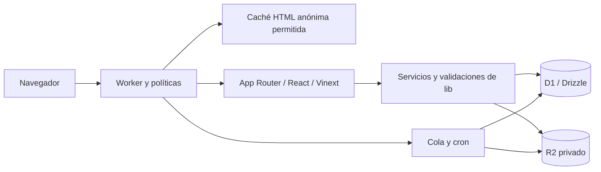

# Contexto para continuar el desarrollo de Chile3X

Referencia revisada el 24 de octubre de 2026: GitHub `gprecabarren/chile3x`, rama `main`, checkout `5d42099` más los cambios locales de esta entrega. Se leyó y contrastó la guía técnica del README remoto con la copia local: ambos tenían el mismo blob `f6e248afb278cb944eb6efa20665a32560682532` antes de añadir estos enlaces. Este mapa complementa esa guía y el historial; no sustituye el código ni afirma una auditoría semántica de cada línea.

## Orden para retomar una sesión

1. Leer [AGENTS.md](../AGENTS.md) y la guía técnica de [README.md](../README.md).
2. Revisar rama, SHA, `git status` y diff antes de editar. Una copia con trabajo local no equivale a GitHub ni al despliegue activo.
3. Localizar la superficie en [rutas-aplicacion.md](rutas-aplicacion.md) y las tablas en [esquema-base-datos.md](esquema-base-datos.md).
4. Leer la página/componente, su API, servicio, política y pruebas correspondientes. Para cambios de datos, leer también las migraciones y triggers relacionados.
5. Confirmar la configuración efectiva y flags del entorno cuando la tarea dependa de ellos. No deducir activación, permisos ni entregabilidad de la existencia de una pantalla.

## Producto y entidades

Chile3X es una vitrina para adultos en Chile con anuncios Escort, Agencia y Arriendo; el contacto y los acuerdos se realizan directamente entre las personas. El modelo no equivale a una plataforma de pagos ni de suscripciones automatizadas.

- **Cuenta:** identidad autenticada, datos privados, correo, rol y estado. `users`, `auth_sessions` e identidades de proveedores.
- **Anuncio:** publicación de una cuenta con su propio identificador público, tipo, ciudad, moderación, detalles, servicios y medios. La identidad de cuenta y el handle de anuncio son distintos.
- **Biblioteca exclusiva:** colección propiedad de la cuenta, con archivos moderados y accesos manuales. Vincularla a un Escort no transfiere su propiedad ni convierte enlaces de redes en una biblioteca.
- **Muestra privada:** preparación separada de un anuncio, con token de acceso y caducidad. Compartirla no publica ni crea automáticamente una cuenta.
- **Permiso administrativo:** acceso interno autorizado en D1 y basado en capacidades; tener acceso al repositorio GitHub no concede permisos en el sitio.

## Arquitectura y recorrido de una petición

La base usa React 19, convenciones App Router de Next 16 y compilación Vinext/Vite para Cloudflare. Versiones exactas en `package.json` y `pnpm-lock.yaml`; no asumir que corre en Vercel ni en un servidor Next tradicional.

`worker/index.ts` primero filtra probes, protege muestras, intercepta Telegram, resuelve conflictos de sesión, comprueba bloqueo de correo y limita multipart. Selecciona tema/diseño en servidor, consulta caché admisible, delega el render/API y aplica cabeceras. El optimizador de imágenes tiene una ruta específica; las fotos públicas de perfiles conservan sus originales según la política visual del proyecto.

`db/index.ts` obtiene el binding `DB` y deduplica el cliente por petición. No añadir caché global de identidad ni pasar todo el esquema a Drizzle para activar consultas relacionales que no se usan.

## Flujos del sitio

### Registro, acceso y sesiones

`app/api/auth` → `lib/auth.ts` y módulos del proveedor → `users`, identidades, tokens e intentos → cookie de sesión y preparación de contexto del navegador.

La sesión pública y la administrativa se aíslan. `BrowserSessionSetup`, `BrowserSessionBoundary`, `worker/session-isolation.ts` y las políticas de sesión coordinan pestañas y conflictos; una cookie de navegador no sustituye una credencial. El acceso administrativo usa GitHub y su concesión vigente en D1. Google, Apple y X tienen contratos y configuración propios: revisar su política y estado antes de describirlos como habilitados.

Desde la revisión del 28 de octubre, las invitaciones validan el formato de usuario/correo y consultan el perfil público de GitHub para comprobar que existe y es personal. Se reserva su ID estable. Esa consulta no demuestra la propiedad del correo: el callback sigue exigiendo el correo reservado entre los verificados de `/user/emails`. Solo el propietario protegido puede gestionar accesos y corregir el usuario de una invitación sin cuenta vinculada, conservando correo/nivel y registrando el cambio. Las identidades ya vinculadas no se reasignan. La recuperación tras rechazo ofrece `select_account=1`, que inicia OAuth con selector de cuenta; no altera permisos ni omite el estado de OAuth.

La consulta pública de cuentas vive exclusivamente en `admin-github-account`, utiliza las credenciales OAuth existentes en el servidor y registra indisponibilidad sin secretos. Las reglas de formato y mensajes de `admin-access-validation` pueden compartirse con el formulario; ese módulo no accede a credenciales ni hace consultas a GitHub desde el navegador.

El acceso administrativo normal también fuerza `prompt=select_account`, para no reutilizar silenciosamente la identidad que sigue abierta en GitHub. Desde acceso denegado, elegir otra cuenta hace un POST de mismo origen a logout con `intent=github_retry`: revoca las credenciales presentadas y elimina cookies de sesión y las dos cookies OAuth de su ruta. Conserva la clave de coordinación del navegador, que no concede identidad. El POST termina en una pantalla local que inicia una navegación nueva hacia GitHub, con enlace de respaldo; así se mantiene `form-action 'self'` sin bloquear la cadena de redirecciones. Visitar un error o iniciar OAuth mediante GET no revoca por sí solo una sesión válida.

La verificación de correo tiene plazos, reenvío y bloqueo en servidor (`email-verification-policy` y Worker). La identidad restringida de recuperación/verificación no tiene todos los permisos de una cuenta activa. Deshabilitación voluntaria, bloqueo administrativo, borrado y recuperación son operaciones diferentes.

El login con contraseña distingue correo no registrado y contraseña incorrecta por decisión expresa de producto; esa distinción revela si un correo tiene cuenta. La consulta queda después de Turnstile y se comprueba un hash de respaldo cuando no existe cuenta o contraseña. `lib/login-form-state.ts` conserva únicamente el correo normalizado durante cinco minutos en una cookie `HttpOnly`, `Secure`, `SameSite=Lax`, limitada a `/ingresar`; nunca incluye la contraseña ni pone el correo en la URL. La cookie se elimina al ingresar correctamente o pasar a reactivación. Esta medida no acredita por sí sola límites externos de frecuencia.

### Crear, editar y publicar anuncios

`app/mi-cuenta/ProfileForm.tsx` → `/api/perfiles/nuevo` o `/api/perfiles/:id` → `readProfileSubmission` → `createProfile` / `updateProfile` en `lib/profile-submission.ts` → D1 → destino privado/confirmación.

La creación asistida y edición administrativa reutilizan la validación central. El tipo queda fijado al crear. Normalmente hay un Escort fuera de papelera por cuenta; existe una excepción de identidad controlada por servidor y reflejada en triggers. No generalizarla ni copiar sus datos personales a documentación.

El borrador y el envío a revisión son intenciones distintas. El envío normal queda `pending`; la aprobación administrativa se hace mediante `/api/admin/profiles/:id/status`. Los estados permitidos son `draft`, `pending`, `approved`, `paused`, `rejected` y `expired`, además de estados independientes de verificación y revisión médica. No asumir que todos están expuestos en cada interfaz.

Una edición relevante normal vuelve a revisión. Un cambio solo de contactos conserva un anuncio aprobado. La edición administrativa tiene una opción autorizada para conservar moderación. La versión y los cambios se guardan con `guardedBatch`; si la revisión quedó antigua, responder `409` sin repetir automáticamente la escritura.

La agenda usa `lib/travel-date-policy.ts`: los viajes nuevos o modificados admiten desde hoy en `America/Santiago` hasta el 31 de diciembre del año siguiente. El servidor vuelve a comprobar el reloj antes de escribir. Un viaje ya guardado puede conservarse sin cambios al editar contactos o notas; modificar ciudad o fechas exige el período vigente. Las muestras se pueden editar con esa misma excepción, pero su publicación exige fechas vigentes. El perfil público omite viajes terminados y fechas inválidas sin borrar el historial guardado. Los selectores históricos de nacimiento y filtros mantienen sus límites propios.

El formulario comparte datos con agencias, arriendos y muestras: no esconder campos solo visualmente ni relajar la validación de servidor por cambiar el layout.

### Visibilidad pública y SEO

`publicProfileCondition` exige anuncio aprobado, propietario activo, sin ocultamiento y sin papelera. La pausa, el estado de moderación, `owner_hidden_at`, la papelera y el estado de cuenta no son intercambiables.

`lib/directory.ts`, políticas de categorías/orden y consultas de perfiles construyen catálogo y filtros. `app/perfil/[slug]/page.tsx` renderiza el detalle; el handle público y las rutas históricas tienen su política de canónica. El contenido solo digital usa `content_only`: se declara explícitamente, no se deduce de OnlyFans, Arsmate o de una colección privada. Mantener sus exclusiones de categorías y servicios presenciales.

Metadatos globales, SEO de cada diseño de inicio, metadatos de páginas informativas y cuerpo visible son capas distintas. Conservar títulos, H1, canónicas, robots, JSON-LD y sitemap. Los valores predeterminados del código son respaldos; los valores efectivos suelen estar en D1.

### Medios y documentos

La aprobación individual/masiva está disponible en Medios, Editar anuncio y Gestionar fotos y videos; la previsualización permite la revisión conjunta. Todos usan las mismas APIs, capacidades, revisión explícita y auditoría. La consulta administrativa autorizada incluye pendientes aun en anuncios publicados; visitantes conservan únicamente aprobados. Publicar no aprueba archivos. Los conflictos nativos regresan con aviso y los interceptados se muestran dentro de la página. La aprobación conjunta también resuelve reemplazos pendientes conservando el ID público, con transacción y limpieza duradera de la base retirada. Ver [QA de moderación del 29 de octubre](qa-moderacion-medios-2026-10-29.md).

Editor de medios → políticas de imagen/video y preparación local cuando corresponde → API autenticada → R2 más referencia D1 → moderación del archivo → lectura autorizada.

Los medios y el anuncio se moderan por separado. No retirar la publicación aprobada al subir un archivo nuevo ni perder la foto principal aprobada antes de aceptar el reemplazo. `/media/:id` vuelve a comprobar propietario/estado del archivo y anuncio; soporta rangos sin saltarse autorización. Documentos de identidad, salud, evidencias y adjuntos tienen rutas y reglas propias. R2 no es un bucket público ni una copia de los datos de Git.

Privacidad manual, recorte, marca de agua, formatos, tamaños y duración se consultan en `profile-media-upload`, `photo-edit-policy`, `verification-documents`, `video-policy` y `video-validation`. Las cifras antiguas del README no deben reemplazar esos contratos.

`ProfileMediaManager`/`AdminPhotoTools` comparten la foto principal, su vista previa y la galería entre cuenta normal, administración y muestras. Las herramientas de fotos guardadas son visibles sin abrir el editor: aplicar/quitar marca de agua y aplicar/quitar difuminado, incluyendo la principal; el difuminado normal respeta el ajuste de servidor. Los botones preparan vistas previas antes de confirmar. La base limpia solo permanece temporalmente en la pestaña: los efectos ya incorporados en archivos antiguos requieren un original limpio para quitarlos.

Revisión del 30 de octubre: selector y arrastre múltiple comparten `selectGalleryFiles` y `useMediaFileDrop`. Los pasos de principal/fotos/videos separan la selección local del guardado, con confirmación arriba y abajo y un máximo de dos tarjetas fotográficas por fila cuando caben. La biblioteca exclusiva también separa fotos/videos, conserva 20/4 archivos y sus accesos privados, y reutiliza el editor de recorte. Las herramientas de fotos guardadas explican cómo habilitarlas. El listado de muestras abre la presentación en otra pestaña y la conversión tiene un desplegable propio debajo de Editar datos. Ver [QA de carga múltiple](qa-carga-multiple-2026-10-30.md).

El mismo gestor muestra foto principal, fotos de galería y videos de galería en ese orden. Cada sección de galería tiene selector, cola, confirmación de carga y archivos guardados propios; enviar una no envía la otra. Las opciones globales de archivos seleccionados aplican/quitan marca de agua tanto a fotos como a videos; el difuminado solo afecta fotos. Videos también tiene un control masivo propio. `gallery-media-options` descarta la preparación solo cuando cambia la opción, vuelve al original de video y conserva recorte, recortes fotográficos y zonas de privacidad. No altera cargas completadas ni archivos guardados. El orden de las muestras se ajusta entre archivos del mismo tipo, manteniendo todos los IDs en el contrato de reordenación. Ver [QA de lotes del 29 de octubre](qa-medios-lotes-2026-10-29.md).

`VideoTrimEditor` permite seleccionar inicio/final sobre el original antes de cargar, con controles numéricos, deslizadores y reproducción del fragmento. `prepare-video` recorta imagen y sonido en el dispositivo mediante Mediabunny, aplica marca de agua si corresponde e invalida la preparación al cambiar opciones. Original máximo 50 MB; resultado máximo 15 segundos y 12 MB, validado también en servidor antes de R2. Solo se guarda el resultado confirmado; no se conserva el original como objeto adicional. Los demás flujos de video que no pasan un recorte conservan su límite previo. Evidencia y límites en [qa-recorte-acceso-2026-10-28.md](qa-recorte-acceso-2026-10-28.md).

La edición de una foto guardada por su propietario usa `GET/POST /api/perfiles/:profileId/media/:mediaId/procesar` y `lib/owner-photo-edit.ts`. Una foto aprobada se conserva mientras una fila nueva queda pendiente. El servidor escribe en metadatos privados de R2 el puntero `replacesMediaId` y valida mismo anuncio, imagen pública y aprobación de la base; nunca acepta ese puntero desde el cliente. El editor y el cupo cuentan el par como una foto lógica, mientras almacenamiento cuenta los bytes de ambas versiones. Al aprobar, se publica la nueva versión en el ID público original y se retira la fila pendiente para mantener compatibles las referencias de HTML almacenado en caché. Cancelar la edición pendiente devuelve la aprobada al editor. Las ediciones administrativas y de muestras mantienen sus reglas de aprobación existentes.

«Eliminar todas las fotos» exige escribir `ELIMINAR`; incluye principal y galería, conserva videos y archivos seleccionados sin subir. Usa las APIs existentes con revisiones y permisos, e incluye ambas versiones de una foto pendiente de reemplazo. El lote es secuencial y se detiene ante la primera respuesta fallida o incierta, sin reintento automático. No requiere migración de esquema. Ver [QA de paneles, medios y acceso](qa-paneles-medios-acceso-2026-10-27.md).

### Historias y actividad

`lib/stories.ts` y `story-upload.ts` seleccionan/cargan historias; `story-data.ts` define sus reglas y `story-order.ts` sus fechas y orden. El directorio acota las historias a sus anuncios mostrados. `app/historias/StoryRail.tsx` implementa rail, actividad, pestañas móviles y visor con foco/teclado.

Las historias expiran y se limpian mediante `worker/story-cleanup.ts`. No ejecutar mantenimiento remoto para probar un visor. Los rótulos relativos usan un reloj compartido iniciado tras hidratar: no calcular la hora actual independientemente durante SSR y el primer render cliente.

### Interacciones, mensajes y agencias

Favoritos, likes, reseñas, reportes y avisos de cambio de ciudad viven en APIs de perfiles y servicios específicos. Las reseñas las aprueba/rechaza el propietario; administración consulta/elimina según capacidad. Un pendiente no se vuelve público por estar visible para su autor.

`lib/internal-messages.ts` y `/api/mensajes` verifican participación, estado público del anuncio, bloqueos y límites de frecuencia. Historial, no leídos, silencio y bloqueo son estados distintos. La presencia se deriva de actividad reciente; no representa disponibilidad comercial. El horario usa `America/Santiago` y los contactos registrados no equivalen a clientes ni a mensajes realmente enviados.

La etiqueta «En línea» usa la actividad de la cuenta de los últimos tres minutos. `PresenceHeartbeat` registra actividad con sesión, pestaña visible e interacción reciente, como máximo cada 45 segundos. `ProfileOnlineBadge` comparte un controlador de navegador que consulta por lotes hasta 60 anuncios visibles cada 45 segundos y al volver a la pestaña; corrige así las etiquetas iniciales de HTML anónimo almacenado en caché. `GET /api/presencia` solo devuelve IDs públicos confirmados, sin identidad de cuenta ni horas, y no escribe actividad. Las muestras no se suscriben. No interpretar esta etiqueta como un horario de atención.

Los contactos WhatsApp de anuncios y del portal excluyen sesiones administrativas y contextos de cookies ambiguos en servidor mediante `lib/contact-traffic.ts`, antes de escribir contadores o cookies de visitante. El navegador también omite solicitudes y eventos de medición en contexto administrativo; ese marcador visual no concede permisos ni reemplaza la comprobación de servidor. Los enlaces siguen abriendo su destino. La exclusión opera desde esta corrección y no identifica ni descuenta retroactivamente clics históricos.

Las solicitudes de asociación agencia–Escort requieren aceptación de la cuenta propietaria. Consultar `agency_members`, `agency_membership_requests` y las APIs de agencias/asociaciones antes de cambiar el vínculo.

### Contenido exclusivo y muestras

`lib/exclusive-content.ts` conserva colección por cuenta, vínculo opcional con un Escort y permisos de compradores. `/contenido/:id` sirve medios después de autorización, también para bibliotecas que no dependen de la publicación del anuncio. Los cobros se acuerdan fuera del sitio; no crear un checkout por inferencia.

`private-sample-policy.ts` y `private-samples.ts` separan muestras, formulario saneado, caducidad, seguimiento de contacto, medios y conversión autorizada. `/admin/muestras` filtra nombre/usuario, teléfono/WhatsApp, región, ciudad, género, procedencia, estado y contacto; pendientes primero, contactados después. WhatsApp abre el contacto sin marcarlo automáticamente; la marca manual guarda fecha y administrador. Cada tarjeta permite copiar su enlace privado: recupera el mismo, sin renovar su plazo, o lo crea si aún no existe. La copia conserva las revisiones de colaboración y ofrece selección manual si el navegador deniega el portapapeles. La procedencia admite Sexosur, Publiescort, Relaxchile, Elsilencio y Otros.

`/muestra/:usuario` y sus archivos son privados y noindex; las rutas antiguas por ID siguen siendo alias, con cookies acotadas al identificador usado. `private-sample-links.ts` cifra los enlaces recuperables mediante AES-GCM, dominio independiente de la clave protegida existente y autenticación del ID. Copiar/recuperar no renueva ni rota el enlace. Los hashes antiguos no permiten recuperar su token: se puede conservar pegando el enlace vigente en el panel, o crear uno persistente sin invalidar el anterior vigente. Revocar invalida ambos. Nunca registrar tokens ni cifrados en auditoría.

La presentación de muestras usa `app/perfil/[slug]/page.tsx` y los mismos componentes de perfil, mapa, reseñas, contacto y acciones. `preview` deshabilita las interacciones y la protección antispam sin alterar tamaños ni crear estadísticas públicas. El contenedor compartido `directory-root` aplica los mismos estilos de ambos temas. Los mapas de ciudad se permiten únicamente como frames de Google Maps, sin referrer; los scripts/conexiones de analítica siguen excluidos. Los cambios futuros de apariencia se hacen en esos componentes compartidos y deben verificarse también en muestras (regla persistida en AGENTS).

`PrivateSampleShell` reutiliza `PublicHeader` y `DirectoryCityBar` en modo `preview`: conserva las tres franjas del anuncio real, pero no consulta ni muestra identidades, contadores o actividad del administrador; contactos y selector de ciudad permanecen demostrativos. Los metadatos de la muestra son genéricos y usan el recurso de marca con fondo negro compartido por `lib/seo.ts`, sin nombres, correo, token ni imágenes privadas. Se mantienen autenticación/token, archivos privados, CSP y `noindex`; la previsualización de redes sociales puede conservar su propia caché de mensajes antiguos.

La muestra vence a los 7 días y aparece en Papelera aunque el cron aún no haya materializado el vencimiento; restaurar conserva el enlace y concede 7 días nuevos. La retención es de 30 días desde su entrada en papelera. `private-sample-cleanup.ts` comprueba nuevamente el estado al borrar y respeta restauraciones concurrentes. Las convertidas se retienen 30 días sin borrar los objetos transferidos al anuncio.

`SampleMediaManager` reutiliza `ProfileMediaManager` y `AdminPhotoTools`: foto principal, galería, marca de agua, privacidad, videos, orden y efectos. Los endpoints dedicados `/api/admin/muestras/:id/media` y sus hijos verifican permiso, revisión, reserva y caducidad; los límites multipart del Worker incluyen estas rutas. Solo se conserva la versión final del archivo en R2 privado. Elegir nueva principal conserva la anterior en galería. La conversión transfiere las referencias R2 y sus opciones de edición sin duplicar bytes ni conceder verificaciones.

El listado muestra `Creada por @usuario` resolviendo `created_by` contra las identidades administrativas. El filtro `creator` usa el ID estable de cuenta y se combina en SQL antes del límite de 100, junto con búsqueda, ubicación, teléfono, género, procedencia, contacto y estado. Se conserva al cambiar de papelera o tras las acciones del listado. Las opciones incluyen cuentas activas con las capacidades reales de creación, aunque no tengan muestras, y autores históricos identificados como sin acceso actual; aparecer como autor no concede permisos. No hay columna ni migración nueva. Evidencia en [qa-sesiones-creadores-2026-10-28.md](qa-sesiones-creadores-2026-10-28.md).

La galería se titula «Galería pública de muestra» para representar su presentación; sus archivos siguen protegidos. La distribución y acciones de tarjetas viven en `app/mi-cuenta/profile-media-manager.css`, compartido con anuncios reales, sin comprimir botones en la columna de metadatos. La papelera permite eliminación definitiva desde el listado y el detalle, exige escribir ELIMINAR y conserva revisión, recibo y auditoría. La cola de borrado tolera trabajos ya existentes y preserva objetos referenciados por anuncios reales u otras muestras.

Convertir requiere cuenta activa y correo verificado. Si ya posee un Escort, exige confirmar expresamente la cuenta, su revisión y su cantidad actual de anuncios; una guarda transaccional evita cambios concurrentes. La excepción `profiles.admin_escort_limit_override` autoriza exclusivamente el nuevo anuncio creado por administración, conserva el cupo normal de la cuenta y no se traslada automáticamente a otro propietario. La migración `0064_private_sample_workflow.sql` mantiene también la excepción heredada acotada que ya existía. Creación, edición, contacto, enlaces, papelera y conversión guardan auditoría administrativa. Ver [QA de muestras](qa-muestras-2026-10-25.md).

Restaurar un anuncio desde papelera conserva una autorización de Escort adicional ya concedida a ese anuncio administrativo; no crea una excepción nueva ni modifica el límite normal de su cuenta. La restauración sigue requiriendo `profiles.recycle` y las guardas de revisión del recurso.

### Administración, contenidos y comunidad

La navegación y las capacidades de administración se consultan en `_components`, `admin-permissions` y `admin-content-navigation`. Sus editores cubren cuentas, anuncios, medios, reportes, noticias, asociados, contenido/SEO, documentos legales, configuración y otros módulos sujetos a flags.

La coordinación de revisión de publicaciones vive dentro de cada tarjeta de anuncio. El buscador de cuentas anuncia los campos realmente consultados: correo, nombre, usuario, ciudad, teléfono, documento o país. El estado efectivo es una celda del resumen de cuenta, sin una columna alta independiente.

`AdminCollaboration` resuelve destino y método mediante `lib/admin-form-target.ts`, leyendo atributos nativos del formulario y los overrides del botón. Un control llamado `action` puede sombrear `form.action` en el DOM y había desviado el cambio de contraseña a una ruta inexistente. La corrección mantiene validación de origen, revisión, recibos y auditoría. El cambio administrativo invalida las sesiones de la cuenta afectada; el cambio propio conserva la sesión actual y revoca las otras según su API existente. Las verificaciones usan cuentas locales desechables, no cambios de claves reales de producción.

El cuerpo legal y sus versiones están en `legal_documents`/`legal_document_versions`; las aceptaciones por cuenta en `account_legal_acceptances`. Cambiar metadatos de una página no equivale a editar su documento. La ayuda usa audiencia/capacidad y el foro tiene acceso propio; el documento histórico `product-scope.md` no es una lista vigente de funciones deshabilitadas.

La revisión legal preparada el 26 de octubre (`2026.10.26.1`) tiene su fuente en `lib/legal-revision-2026-10-26.ts` y copias de lectura en `docs/legales/`. `0065_legal_privacy_revision.sql` archiva el contenido canónico anterior y publica los nuevos bloques para el texto canónico `2026.10.14.3` y la publicación de Privacidad `2026.10.17.1` cuyo JSON se comparó expresamente con la base durante la comprobación remota del 27 de octubre; conserva `draft_json`, aceptaciones y versiones posteriores. Las filas con contenido distinto o historial incompatible requieren comparación y publicación desde `/admin/documentos-legales`, sin forzar la sustitución. El bootstrap `lib/legal-defaults.ts` y sus metadatos iniciales permanecen históricos: sin aplicar la migración no se presenta un texto nuevo con versión antigua. Los nuevos bloques siguen admitiendo edición, vista previa, borrador e historial mediante las APIs existentes; no se crean rutas públicas ni un segundo editor. Ver [hallazgos y medidas pendientes](revision-legal-y-respaldo-tecnico-2026-10-26.md): la revisión documental no implementa consentimiento granular, bloqueo/exportación, cambios en métricas o el flujo médico, ni activa pagos.

Telegram se integra en el Worker con webhook, D1, cola, outbox y cron; vinculación de cuenta, identidad administrativa, membresía, novedades y moderación son contratos distintos. No enviar mensajes, activar proveedores ni cambiar espacios externos al revisar código.

La migración `0066_legal_history_cleanup.sql`, solicitada expresamente por el propietario el 27 de octubre, elimina de `legal_document_versions` ocho instantáneas anteriores: Términos `2026.10.27.2`, `2026.10.27.1`, `2026.10.26.1`, `2026.10.14.3` y Privacidad `2026.10.27.1`, `2026.10.26.1`, `2026.10.17.1`, `2026.10.14.3`. El editor sigue leyendo el historial guardado, sin ocultación visual ni lista de exclusiones. La limpieza protege la versión vigente de cada documento, conserva íntegra `legal_documents` (incluido cualquier borrador) y mantiene las constancias originales de aceptación de las cuentas. El código de la migración por sí solo no demuestra su aplicación remota.

## Base de datos y persistencia

El inventario actual del esquema tipado tiene **92 tablas, 813 columnas y 105 claves foráneas**; hay **67 migraciones SQL** con la revisión legal `0065` y la limpieza de historial `0066`, que no añaden tablas permanentes. Son conteos de código, no una inspección de producción. Los comentarios antiguos que hablan de 62 tablas y los inventarios de otros commits no reemplazan esta medición. El detalle completo de columnas, enumeraciones, índices y relaciones está en [esquema-base-datos.md](esquema-base-datos.md).

Dominios principales:

| Dominio | Tablas o familias |
| --- | --- |
| Identidad | `users`, `auth_sessions`, `account_*_identities`, intentos de proveedores, `account_tokens`, presencia y aceptaciones legales |
| Administración | `admin_github_*`, auditoría, notificaciones, recibos de mutación y revisiones |
| Publicación | `profiles`, `profile_details`, `profile_tags`, `profile_services`, `listing_periods`, agencias y solicitudes |
| Medios y confianza | `profile_media`, `profile_verification_files`, reportes/evidencias, muestras y sus medios |
| Interacciones | visitas/contactos, favoritos, likes, reseñas, bloqueos, alertas de ciudad y `profile_statuses` |
| Mensajes y bibliotecas | `message_*`, `exclusive_content_*`; `profile_exclusive_access` conserva un contrato heredado que debe verificarse antes de modificar |
| Contenido | noticias/medios, sitios asociados/grupos, ajustes, ayuda y documentos legales/versiones |
| Comunidad | `forum_*` y `telegram_*` |
| Operaciones | `operational_*`, correos, retenciones, trabajos de eliminación y coordinación |

Las restricciones de identidad, límite Escort, revisiones, compatibilidad de etiquetas y limpieza de objetos incluyen triggers de migración. Un cambio en tablas hijas puede incrementar la revisión del recurso. Revisar FK/cascadas y referencias R2 antes de una eliminación. GitHub respalda fuente/migraciones, pero no D1, R2, secretos ni configuración externa; el rollback del Worker no revierte datos.

## Mapa rápido de código compartido

| Trabajo | Referencias principales en lib/worker |
| --- | --- |
| Acceso y proveedores | `auth`, `session-*`, `browser-session-view`, `google-*`, `apple-*`, `x-*`, `turnstile-*`, verificación y recuperación |
| Cuenta | `account-*`, `creation-provenance`, datos, eliminación, reactivación y username |
| Catálogo/perfil | `directory`, `directory-order`, `profile-*`, `public-profile-visibility`, popularidad de ciudad |
| Medios | `media*`, `image-*`, `photo-*`, `face-privacy`, `video-*`, `verification-documents`, `report-evidence` |
| Comunidad/interacción | `internal-messages`, `stories`, `story-*`, `forum*`, `telegram*`, `profile-interactions` |
| Configuración/editorial | `site-settings`, `home-*`, `information-seo*`, `news*`, `legal-*`, `faq`, reglas, asociados y contactos |
| Coordinación/observabilidad | `collaboration`, `admin-*`, `operations`, `email-history*`, trabajos de correo y retención |
| Infraestructura | Worker, `public-cache`, `site-presentation`, aislamiento de sesión, correo entrante y limpieza |

## Interfaz y reglas de mantenimiento

Tema global `classic`/`liquid-glass` y diseño del inicio `classic`/`compact` son ejes separados seleccionados por servidor. Compartir estructura y controles; el CSS exclusivo de Glass conserva su carga condicional y nombre versionado. No crear URLs duplicadas por tema ni selección solo en almacenamiento del navegador.

DM Sans local es la familia global, con excepciones técnicas para código/IP. Cambiar tamaños o pesos no implica cambiar la fuente. Mantener radios mediante `corner-tokens.css`, botones compartidos y selects nativos; evitar contextos de apilado que atrapen diálogos.

En escritorio, los campos de creación mantienen etiquetas de 16 px y ayudas de 14 px. Hasta 860 px, los paneles privados usan texto principal de 14 px, secundario de 13 px y metadatos de 12 px; los estados informativos tienen tamaño intrínseco de 11,5 px. Los valores de inputs/selects siguen en 16 px y las acciones conservan sus objetivos de 44 px. Títulos y rellenos de tarjetas móviles tienen una escala propia, sin reducir la tipografía de PC. Los resúmenes de Horarios y Agenda muestran su explicación antes de abrirse; los horarios también indican los días seleccionados. WhatsApp flotante se ancla a la derecha desde 1100 px, manteniendo el diálogo, el movimiento y las reglas móviles existentes. Evidencia de los flujos en [qa-paneles-viajes-2026-10-24.md](qa-paneles-viajes-2026-10-24.md) y del equilibrio móvil en [qa-panel-balance-2026-10-25.md](qa-panel-balance-2026-10-25.md).

La portada clásica alinea arriba su arte en escritorio para conservar la cabeza completa. La nota bajo regiones admite un vacío explícito y no deja un párrafo vacío; la descripción de cobertura usa lenguaje del directorio ya publicado. Los textos continúan en los JSON de ajustes de cada diseño, editables con su SEO desde administración. Los valores efectivos de D1 y los predeterminados del código son capas distintas; la clave de caché pública incluye la revisión de ajustes. El listado administrativo de cuentas coloca su coordinación dentro de la tarjeta sin cambiar el alcance ni la revisión del recurso.

Esta entrega añadió Hombres derivado de Masculino en cliente/servidor; controles legibles; íconos compartidos de contacto; horarios y Agenda de viajes desplegables. Las selecciones se conservan y la validación abre los grupos necesarios. También corrige la próxima disponibilidad semanal y la hidratación de actividad. Evidencia en [qa-escort-form-2026-10-24.md](qa-escort-form-2026-10-24.md).

## Desarrollo, QA y publicación coordinada

Usar el gestor/versiones fijados, instalación congelada, typecheck, lint y pruebas proporcionales. `pnpm test` incluye build; no hacer builds simultáneos sobre `dist`. El desarrollo local usa `.wrangler/visual-state`; los scripts pueden escribir datos y algunos apuntan a producción: leerlos antes de ejecutarlos.

Para Vinext local, el argumento de escucha es `--hostname`, no `--host`. Los proxies de `qa-account-stories` dependen de la instancia en `127.0.0.1:3880`. Crear y limpiar exclusivamente fixtures locales, con verificación de prefijos/propietarios. No reutilizar credenciales de prueba antiguas ni publicarlas.

**Instrucción del propietario:** toda publicación en Cloudflare debe tener su commit y push correspondientes en GitHub. `main` está documentada como vinculada a Workers Builds: enviar un commit puede publicar y no debe duplicarse con un despliegue manual paralelo. Cuando se vaya a publicar, revisar exactamente qué archivos se incluyen, ejecutar las comprobaciones, enviar ese SHA y verificar checks, versión activa y rutas afectadas. Registrar SHA y versión juntos. Si algo falla, mantener explícito el estado parcial hasta sincronizar ambas partes.

La revisión de contexto se realizó localmente y no cambió la visibilidad del repositorio. El estado de publicación del trabajo se verifica por separado mediante el commit y su despliegue. GitHub mostraba el repositorio público al leer sus metadatos. La recomendación para este proyecto comercial es mantenerlo privado; cambiar la visibilidad es una operación separada.

## Qué actualizar al cambiar el proyecto

- Flujos, permisos o decisiones de producto: este mapa y la guía del README correspondiente.
- Esquema: fuente tipada, migración revisada, mapa D1 y pruebas de invariantes.
- Rutas: inventario de rutas y enlaces de navegación/SEO afectados.
- Presentación: reglas de AGENTS, ambos temas/diseños y evidencias responsive.
- Publicación: commit GitHub, checks, versión Cloudflare y resultado verificado; no presentar QA local como producción.

Los datos vivos, secretos, permisos externos y la salud real de proveedores requieren consulta específica cuando una tarea los involucre. Este contexto persiste en archivos del repositorio para retomarlo sin depender de una conversación anterior.

El aviso +18 muestra debajo una línea pequeña de versión y última actualización. Vite obtiene el SHA corto y la fecha del commit de Git durante la compilación, con hora de Chile; cada build de main incorpora automáticamente su referencia. No consulta GitHub ni expone credenciales al navegador. Sin repositorio Git se identifica como versión de desarrollo.

Las galerías de cuenta normal, administración y muestras comparten controles Izquierda/Derecha, con guardado por movimiento. Se ordenan fotos y videos por separado, sin mover la principal ni contenido exclusivo. `media-order` valida la permutación exacta y `profile-media-order` guarda los índices mediante revisión transaccional. Las fotos pendientes y su base aprobada comparten posición para conservarla al aprobar o cancelar; los editores administrativos muestran la misma vista lógica de medios que la cuenta normal. Ver [QA de orden de galería](qa-orden-galeria-2026-10-29.md).
