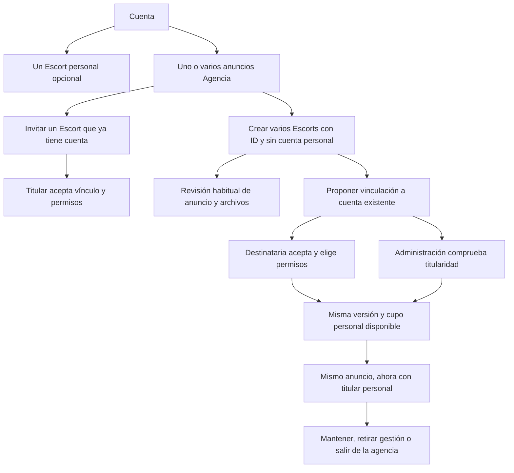

# Agencias, titularidad y permisos — 31 de octubre de 2026

## Comportamiento implementado

- Una cuenta combina un Escort personal, varias agencias y varios arriendos. Cada agencia crea varios Escorts en custodia con ID estable sin cuentas/correos ficticios; los adicionales permanecen ligados a esa agencia.
- Crear o aprobar un Escort en custodia no lo hace visible si su agencia no cumple publicación/visibilidad. El panel distingue aprobación de visibilidad pública. La presencia de esos perfiles identifica actividad de la agencia, no de la persona representada.
- Invitaciones a Escorts con cuenta desde agencias incluso borrador/pendiente/pausadas: mensaje visible en Home, aceptación, avisos y vigencia de siete días. Asociación no exclusiva, incluso dentro de una misma cuenta. No incluye perfiles ocultos, cuentas inactivas, custodias ajenas o Venta solo de contenido; no duplica invitaciones vigentes ni vínculos aceptados.
- Gestión revocable por anuncio: datos/descripción, contactos, categoría, fotos/videos/opciones/orden, historias, visibilidad, revisión, estadísticas y comentarios. Documentos requieren permiso específico adicional. La agencia no recibe contraseña/seguridad, inbox personal, biblioteca privada ni permiso de borrar anuncios de titular ajeno.
- La agencia propone una custodia al correo de una cuenta existente activa/verificada sin Escort personal. Destinatario revisa y acepta; administración comprueba titularidad en `/admin/agencias`. Ambas revisiones deben coincidir con el perfil actual. Cambiar después el anuncio obliga a confirmar de nuevo. No basta conocer un correo ni aceptar una invitación para tomar control.
- Al completar: cambia titularidad del mismo perfil, sin cambiar ID, handle, enlace, archivos, historias, reseñas o estadísticas. La destinataria elige conservar gestión/documentos; puede retirar permisos o salir conservando el anuncio. Las conversaciones y biblioteca privada anteriores permanecen en la cuenta anterior.
- VIP/Premium/Bronze se eligen también para Agencia. Venta de contenido usa el cupo personal; Solo contenido no se incorpora como Escort de agencia. La guía al final de Mis anuncios incluye cuatro flujos visuales y las limitaciones compartidas.

## Problemas corregidos y límites

La relación antigua era principalmente un vínculo público: no tenía una autorización central para editar perfiles ajenos ni un traspaso seguro de perfiles sin cuenta. El permiso ahora se verifica en lecturas y dentro de la transacción de escritura. Las revocaciones invalidan editores abiertos; no se atribuye a la titular una acción efectuada por otra cuenta.

La aprobación de una propuesta y su cancelación podían cruzarse si se comprobara solo antes de escribir. Se comprueba también estado/revisión en la transacción. La confirmación manual no puede completar una propuesta cuyo anuncio cambió o cuya destinataria ya ocupa su cupo.

Los guardados de medios/documentos de una misma página avanzan únicamente la versión propia confirmada. El formulario de datos y las acciones posteriores usan esa versión, conservando el rechazo de cambios ajenos. Los documentos sustituidos/retirados tienen limpieza R2 duradera y sus verificaciones vuelven a revisión cuando corresponde.

La sustitución reiterada de portada podía reservar mal el espacio de la principal anterior y superar la galería prevista. Ahora se reserva ese espacio, se admite solo una principal pendiente y se comprueban límites lógicos al subir/aprobar sin duplicar fotos que tienen un reemplazo pendiente.

El padre no se elimina dejando custodias huérfanas; se restaura antes que un hijo. La eliminación de cuenta retira primero custodias, conserva perfiles ya trasladados a otras cuentas y no arrastra datos personales de otras cuentas.

Las asociaciones anteriores conservan su carácter de asociación: migrarlas no concede gestión ni acceso a documentos. La excepción histórica exacta de cupo se conserva desde el trigger anterior, sin copiar datos privados al nuevo archivo de migración ni convertirla en una bandera editable.

Los avisos usan el servicio de correo existente. El panel no depende de recibirlos. Se suprimen avisos cancelados/vencidos y se limita cada ejecución a cinco trabajos. Un resultado incierto queda por comprobar; no se reenvía automáticamente. Solo se reintenta una no tentativa acreditada, hasta cinco veces. La aceptación de un proveedor no garantiza lectura. Retirar permisos impide nuevas lecturas/acciones, pero no elimina copias que una agencia hubiera descargado antes con permiso.

No se transfieren contraseñas, documentos de otros perfiles, conversaciones antiguas ni biblioteca privada global. Antes de salir conviene revisar WhatsApp/teléfonos/redes del anuncio si pertenecían a la agencia. Un mismo Escort puede autorizar a varias agencias; la revisión de versión evita que dos editores sobrescriban cambios sin advertencia, no arbitra sus acuerdos internos.

Los textos editoriales operativos se actualizan puntualmente en `0068`: se conserva el documento publicado previo, borradores, personalizaciones y aceptaciones. No constituye una revisión jurídica exhaustiva de todo el sitio.

## Verificación

- Compilación de producción y 598 pruebas automatizadas aprobadas; comprobación TypeScript y ESLint de los archivos afectados. Las pruebas usan migraciones reales de SQLite/D1 y lotes atómicos, no solo ejemplos de interfaz.
- Nuevos casos: cupo personal + custodias múltiples, integridad FK, preservación de permisos históricos/excepción, invitación propia/no exclusiva, elegibilidad, duplicados, revocación e intentos en vuelo, consentimiento documental, aceptación antes/después de la comprobación, cambio de versión, cancelación, titularidad y conservación de ID/URL.
- Pruebas de correo con proveedor simulado: cancelados, concurrencia del cron, acuse incierto y reintento solo cuando no hubo tentativa. No se enviaron correos de QA a personas reales.
- Navegador real con fixtures locales: creación desde una cuenta con Escort y Agencia, tres custodias, propuesta a cuenta vacía, aceptación, comprobación administrativa, denegación a agencia anterior, concesión/revocación, carga de foto pendiente, historia, edición de contactos y acceso documental.
- Documentos en móvil: declaración específica antes de subir en custodia; guardado, descarga privada, formulario posterior sin falso conflicto, autorización de otra cuenta y revocación que conserva acceso a la titular.
- Dos temas, pantallas de panel/creación/editor/administración en 320, 360, 390, 430, 768, 1366, 1920, 2560 y 3440: 72 composiciones sin desbordamiento horizontal; revisión de capturas de guía, permisos, controles y formularios. Los datos/capturas/credenciales QA permanecen en `outputs/` ignorado.
- Comprobación adicional del perfil público en custodia y de ambos diseños de inicio, en ambos temas y seis anchos de 320 a 3440. El formulario administrativo pendiente se revisó también en 320/390/1366, con confirmación obligatoria y sin desbordamiento.
- Auditoría remota previa únicamente agregada/de lectura: sin relaciones de tipo inválido, galerías con más de diez fotos ni violaciones FK. Los datos personalizados publicados y la ausencia de borradores se comprobaron antes de migrar. El historial reciente mostraba aceptación del relay de correo; no demuestra la recepción de cada aviso futuro.

## Comprobaciones manuales sugeridas

1. Crear una Agencia; con esa misma cuenta crear un Escort personal independiente y dos gestionados. Comprobar que el segundo personal se bloquea y que las custodias muestran su agencia/ID.
2. Elegir categorías en Agencia y enviar cada anuncio/archivo a revisión. Ocultar la agencia: sus custodias no deben aparecer al público, pero siguen disponibles en su panel.
3. Invitar un Escort de otra cuenta. En Home debe aparecer mensaje y permisos; rechazar/cancelar y comprobar que no se puede aceptar un vínculo obsoleto. Probar también asociación con el Escort personal de la misma cuenta.
4. Aceptar gestión sin documentos. Editar desde agencia; comprobar que no abre documentos, seguridad ni biblioteca personal. Luego autorizar documentos desde la titular y retirar únicamente ese permiso.
5. En otra pestaña dejar abierto un editor de agencia. Revocar gestión desde la titular; intentar guardar/cargar/borrar: debe denegarse o advertir conflicto, sin aplicar la escritura.
6. Proponer vincular una custodia a una cuenta verificada sin Escort. Destinataria acepta y administración comprueba. Probar ambos órdenes. Si se edita el perfil entre pasos, debe exigir revisión actualizada.
7. Comprobar el mismo ID/enlace/medios después de vincular. Sin conservar gestión, la agencia anterior debe perder el editor. Mantener solo asociación y luego salir: la titular conserva su anuncio.
8. Probar destinataria que ya tiene Escort: debe bloquearse sin duplicados. Probar cancelar/expirar una propuesta: su vista privada deja de autorizar a la destinataria.
9. Llenar diez fotos más principal. Intentar sustituir principal sin espacio: debe explicar el límite y no borrar archivos. Con espacio, revisar nueva portada pendiente y conservación de la anterior al aprobar.
10. En papelera, retirar custodias antes de eliminar la agencia. Restaurar primero la agencia y luego sus custodias. No se prueban eliminaciones sobre datos de personas reales.

## Publicación y evidencia

Se utiliza exclusivamente el push a `main` y Workers Builds. La preparación de esquema corresponde a `ca1983391cfcb066229c2253048dd16525361653`; `0067` se aplicó desde un checkout aislado de ese commit, antes de activar las funciones. Sus tres comprobaciones de GitHub resultaron satisfactorias y Cloudflare activó `68a96eb7-3bb8-46af-a1b1-f7e0716adc46` al 100 %.

La entrega de funcionalidad incluye este informe y `0068`; su SHA, tres checks, migraciones efectivas y versión activa se verifican juntos al cerrar la publicación. No se despliega manualmente código local ni se confunde una compilación local con la versión servida.
